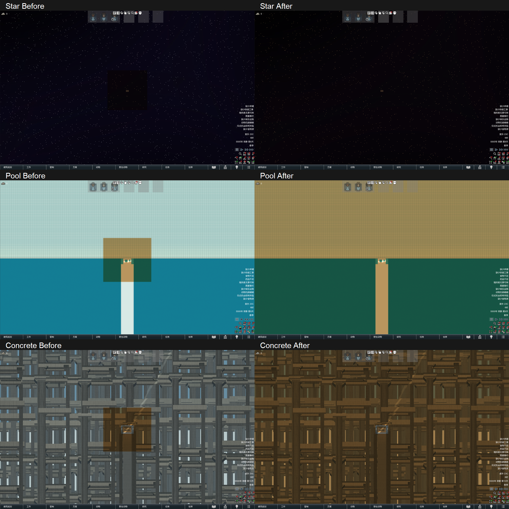
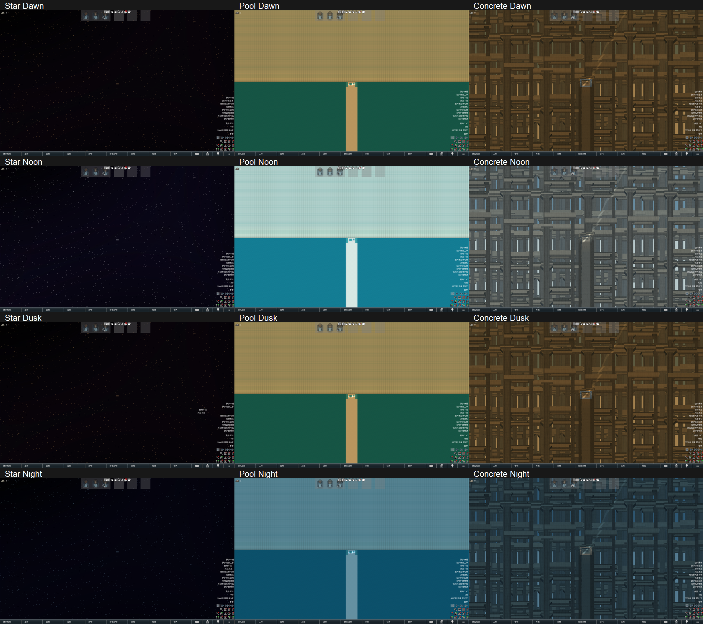

# CameraVisible 外围补光验证

本夹具验证 CQF 的 `MapDrawLayer_CQFPanoramaLighting`。仅使用 RimDevTools 管理的独立离线副本，不参与生产主库编译。

## 运行

`RunChecks.ps1 -RunRoot <目录>` 要求目录内已有完整的 `CQF`、`Poolcore` 测试包镜像，分别包含待测的 `1.7/Assemblies/net10.0/QuestEditor_Library.dll`、`1.7/Assemblies/Poolcore.dll`。两包的贴图、Defs、语言与加载目录也须完整。夹具从镜像内现有 `Quests/Map/Star.xml` 复制测试定义，仅改用带前缀的 `CQF_PL_Star`，并在测试时指定 CQF 场景生成器。

```powershell
./RunChecks.ps1 -RunRoot D:/RimWorld-Dev/TestArtifacts/<本轮目录> -Launch
./AnalyzeScreenshots.ps1 -Evidence D:/RimWorld-Dev/TestArtifacts/<本轮目录>/Evidence
```

脚本检查 `D:/RimWorld-Dev/steam_appid.txt=0`，使用 `-savedatafolder=D:/RimWorld-Dev/SaveData`、`-NoFileLog`、隔离桌面与静音。RimDevTools 负责启动、共享锁、日志与配置事务。测试临时切换开发副本的 CQF、Poolcore、LogSyncMod 目录链接；结束后恢复原目标、Prefs 与 Profiler 配置。已有离线会话占用时拒绝启动，不停止其他测试进程。

## 2026年11月12日结果

最终发布候选从 `ebbe8b7` 已提交源码加本次补光文件独立构建，未混入其他未提交功能。1.7 主库编译零错误、1983 条既有警告；1.6 编译零错误、1735 条既有警告，仅编译验证。Poolcore 与夹具编译零警告、零错误。本次运行包更新范围为 1.7。

RimDevTools 1.0.4.0 实际运行 `D:/RimWorld-Dev/RimWorld.exe`，版本 `1.7.4982 rev1280`，PID 28916；存档目录为 `D:/RimWorld-Dev/SaveData`，进程内三个 Steam AppId 均为 0。原生日志零 ERROR，WARN 原样保留，包括离线 Steam、已安装 Mod 元数据与退出时原生分配提示。doctor 零必需问题，三个非阻断提示为测试项目缺少预览图、本机缺少完整 .NET Framework Targeting Pack、测试镜像不是 Git 工作树。

- **1443 项检查通过**，最终回执为 COMPLETE。
- 覆盖 Star、池核、砼核、普通地图的黎明、正午、傍晚、夜间；每种组合检查原版 200 格矩形的四边和四角，以及范围内与超远视野。
- 检查背景禁用、Map/CameraVisible 切换、UI/Null、原版光照开关、复制、XML 与真实整局存读档。
- 实际相机达到记录位置与缩放。四边与四角测试中心位于 200 格边界，缩放 55；范围内缩放 20；超远缩放 900。相机高度 65，near/far 为 0.5/2000，旋转为原版俯视方向；屏幕为原生 2560×1600、宽高比 1.6。完整参数见 [Cameras.jsonl](Evidence/20261112/Cameras.jsonl)。
- 真实绘制观察验证非空区域的两种材质提交、精确面积、原版区域零重叠、分区互不重叠、高度和渲染层；地图自身与原版外围网格未修改，补光网格实例跨重建与相机变化复用。
- 原生存读档后，三种全景与普通地图都再次检查并截图；背景数据保留，补光层重新建立。

138 张原生截图形成 69 组同镜头对照。对照暂停游戏并冻结时间，只切换新补光层是否提交绘制，场景和镜头保持一致。排除界面、光栅边界及下述雾效采样边缘后，共比较 **53,075,140 个原有区域像素，差异为 0**。其中 13 组池核额外关闭雾效，确认底图原有区域像素不变。普通地图也没有新增补光提交。

池核的正常雾效通过 `_GrabPC_HazeScene` 读取周围像素，最远偏移为 `7 × hazeRadius` 像素；默认半径 1.5。因此修正外围颜色会传播到紧邻边界的少量像素，已观察到 1–4/255 的通道变化。正常雾效对照采用 16 像素内缩范围，无雾及其他场景采用 3 像素光栅内缩范围。界面右侧提示文字另行排除。这些范围记录在 [PixelComparison.json](Evidence/20261112/PixelComparison.json)，没有将其表述为全屏逐像素相同。

下图左侧关闭新补光，右侧开启；只缩小排列原生截图，原图保持不变。





## 性能实测

由原版 Frame profiler 采集实际 `MapDrawer.DrawMapMesh`，两处方法插桩均已匹配并启用。每种场景/开关各采样 3 轮，每轮预热 25 帧、采样 180 帧，交替先后顺序，共 540 帧。绘制观察器在性能阶段已移除。补光入口另用实际调用计时与线程分配计数核对，避免分析器省略极短调用后误认其未执行；下表入口耗时包含观察与插桩成本，未扣除。采样无丢失事件、溢出或不平衡作用域。

| 镜头 | 新增绘制提交/帧 | 补光入口平均 µs/帧 | 补光入口分配字节 | 地图绘制基线→启用 µs/帧 | 实际帧间隔 P95 基线→启用 ms |
| --- | ---: | ---: | ---: | ---: | ---: |
| 原版覆盖范围内 | 0 | 0.87 | 0 | 259.85 → 271.31 | 4.51 → 4.58 |
| 越过一边 | 2 | 2.82 | 0 | 52.54 → 48.66 | 4.36 → 4.31 |
| 越过一角 | 4 | 3.51 | 0 | 44.94 → 55.33 | 4.20 → 4.34 |
| 缩放 900 | 8 | 3.05 | 0 | 294.31 → 298.21 | 4.75 → 4.53 |

范围内启用组出现一次 645.68 ms 的整帧异常值，该组主要异常耗时集中于 `ImGuiRenderFeature`，补光入口该轮平均 0.89 µs；整组帧间隔均值为 5.44 ms，基线为 4.25 ms。数据保留在 [PerformanceSummary.json](Evidence/20261112/PerformanceSummary.json)，未删除异常帧。其余组均值约 4.21–4.29 ms。地图入口总耗时有采样波动，不能将负差值解读为补光提高性能。补光仍有 CPU 提交和 GPU 光栅成本，本轮没有单独隔离 GPU 耗时，不宣称零性能开销。

## 证据与清理

已提交的 [Manifest.json](Evidence/20261112/Manifest.json)、[Process.json](Evidence/20261112/Process.json)、[Checks.txt](Evidence/20261112/Checks.txt)、参数与统计文件用于核对候选及本轮结果。完整原生截图、逐轮性能数据、控制台日志、工具回执和失败轮次保留于：

```text
D:/RimWorld-Dev/TestArtifacts/CQF-PanoramaLighting-20261112-91aefd8b
最终候选证据：Release/Evidence
首轮场景生成失败：Failed-1
第二轮视觉通过但极短性能事件断言失败：Failed-2-VisualsPassed
```

首轮夹具未给 Star 模板指定生成器，并存在路径分隔符校验误报；修正后第二轮完成视觉与存读档检查，性能断言因分析器省略极短调用而停止。补充独立调用计时后完整通过，最终候选另经完整重跑。测试工具共享锁占用的启动拒绝保留在 `Release/receipt-busy.json`，未计为游戏测试失败。

最终 Prefs、Profiler、三个开发目录链接均已恢复。RimDevTools cleanup 状态无活动游戏、残留事务或部署现场。Poolcore 的临时补光源码已删除，原有场景夹具改查 CQF 类型；后续独立更新的 Poolcore 场景源码及运行包保留，当前运行包元数据检查已确认不再包含临时补光类型。
